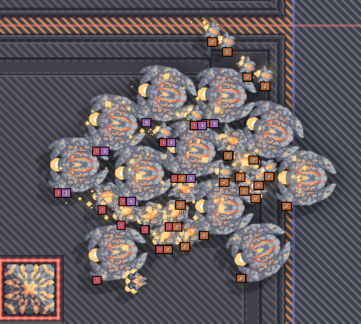

# Better RTS Formation

更方便地管理 Mindustry 中的 RTS 编队。

为单位创建、选择多个编队，并通过清晰的数字角标快速识别单位归属。一个单位可以同时属于多个编队，也可以在非指挥模式下操作编队。

当前版本：1.0.3

## 功能

- 三个按键：添加编队、选择编队、删除编队（默认均未绑定，在控制设置 → Better RTS Formation 分类中配置）。
- 添加编队：按住「添加编队」并拖动框选，或按住后按下数字键 `1-9` / `0`，将单位加入对应编队。
- 选择编队：按住「选择编队」并按下数字键，选中对应编队的单位。
- 删除编队：同时按住「添加编队」与「删除编队」并拖动框选（框以红色显示），移除框内单位的全部编队。
- 设置：可开关「编队角标与严格编队选择」「非指挥模式下也能控制编队」。

## 使用

在游戏的控制设置 → Better RTS Formation 分类中配置三个按键，然后配合数字键 `1-9`、`0` 使用。

模组支持原版 Mindustry 与 MindustryX，桌面端与 Android 端均可运行。

## 构建与安装

- 构建：运行 `./gradlew deploy`，产物为 `BetterRTSFormation-1.0.3.jar`（内含 `mod.json` 与 `classes.dex`），输出到 `build/libs/` 与 `dist/`。
- 开发副本：`构建/BetterRTSFormation/BetterRTSFormation-dev.jar`（仓库外的工作区暂存目录）。
- 安装：将 jar 放入 Mindustry 的 `mods` 文件夹，然后启动游戏。

---

Create, select, and recognize RTS control groups more easily in Mindustry.

Units can belong to multiple groups, with clear numbered badges for quick identification. Groups can also be managed outside command mode.

Current version: 1.0.3

## Features

- Three keybinds: add, select, and delete control groups (all unbound by default; configure them under Control → Better RTS Formation).
- Add: hold the add key and drag a box over units, or hold it and press `1-9` / `0` to assign units to that group.
- Select: hold the select key and press a number to select that group's units.
- Delete: hold the add and delete keys together and drag a box (drawn in red) to strip all formations from the enclosed units.
- Settings: toggle "Enable formation badges and strict group selection" and "Allow control groups outside command mode".

## Usage

Configure the three shortcuts under Control → Better RTS Formation, then use them with the number keys `1-9` and `0`.

Works with vanilla Mindustry and MindustryX, on desktop and Android.

## Build and install

- Build: run `./gradlew deploy` to produce `BetterRTSFormation-1.0.3.jar` (containing `mod.json` and `classes.dex`) in `build/libs/` and `dist/`.
- Dev copy: `构建/BetterRTSFormation/BetterRTSFormation-dev.jar` (workspace staging dir outside the repo).
- Install: put the jar into Mindustry's `mods` folder and launch the game.
